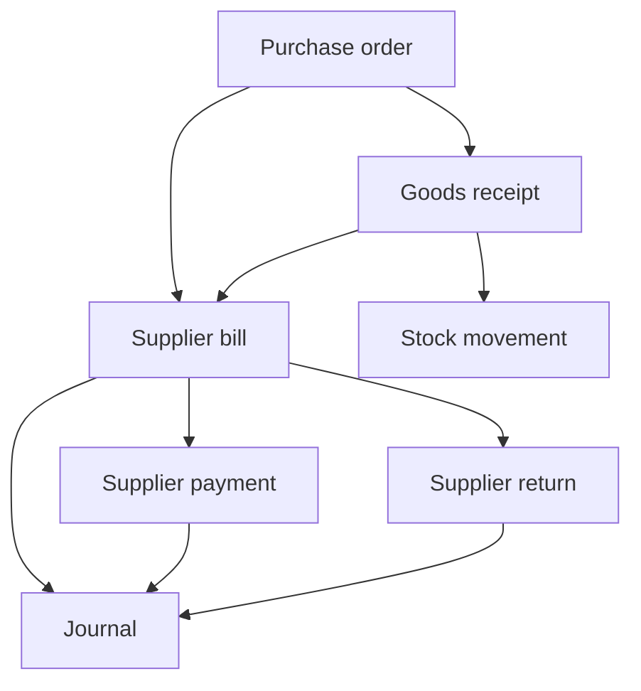
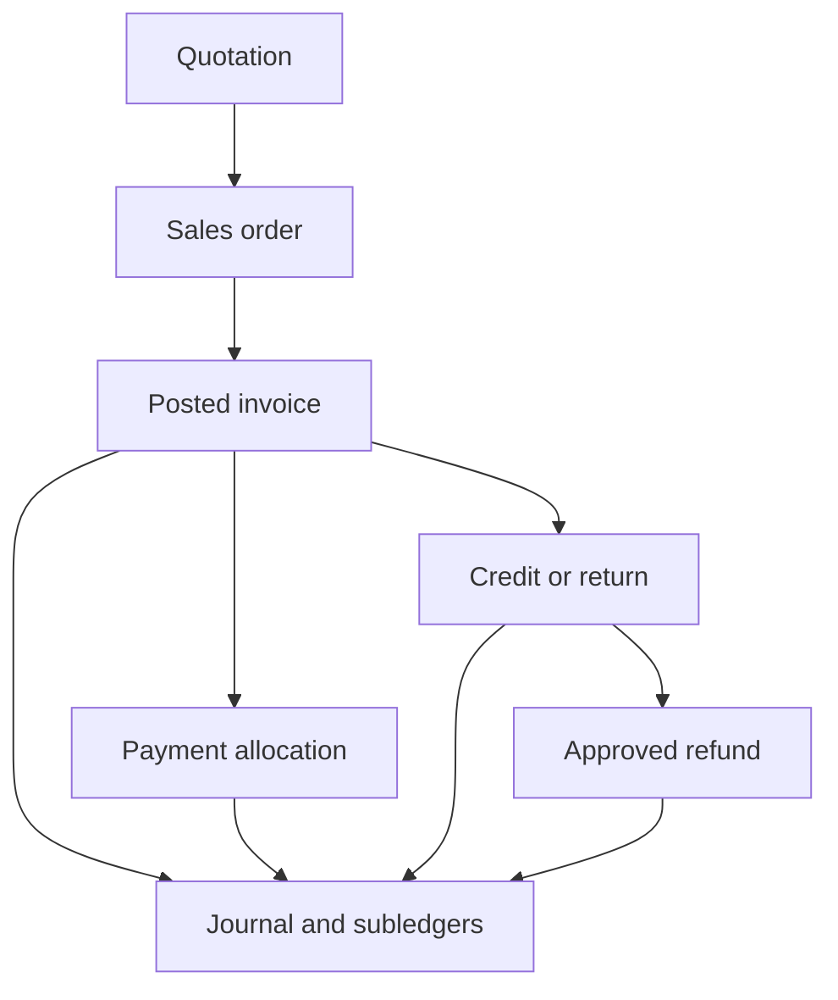
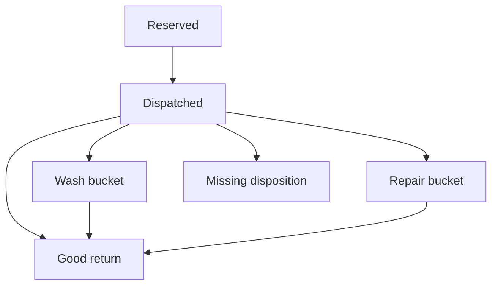

# Source-linked business map

The [machine map](../../workflows/business-map.json) records 68 declared schema entities and 164 foreign-key references at product `ead3a82170e7a34ad625ec6ef8434e5ae65b1609` / v2.5.12. It also inventories 138 exported action declarations from inspected files, 132 page-file routes and 47 source records. [Entity index](ENTITY_INDEX.md) lists the table/field/reference evidence.

This is a semantic organization of static source evidence. Foreign keys do not prove tenant ownership checks, authorization, valid lifecycle transitions or atomicity. Route paths containing groups/parameters are source-file inventory, not independently visited URLs. The action inventory is not a complete call graph or code audit. Graph tools were unavailable; pinned repository schema/source extraction was used instead.

## Commercial document lineage

PO/receipt/bill source ancestry governs remaining quantities. Receipt and bill can recognize different effects depending on the reviewed GRNI model; their combination must never capitalize twice. A linked return must use remaining source quantity/value and original cost. See WB-PHY.J02–07.

Pre-posting documents, earned revenue, open debt, money collection and refunds are separate facts. Digital delivery is an additional capability boundary; an invoice does not establish it. Service advance recognition must not be inferred from invoice date. See WB-SVC, WB-DIG and WB-CORE.J01–04.

## Product-class effects

| Class | Quantity and operational model | Financial distinction |
|---|---|---|
| Physical | Stock levels, movements and cost layers | Sale reduces inventory and recognizes original applicable COGS |
| Service | Delivered work/capability contract; no physical stock | Recognition depends on delivery/policy; collection settles debt |
| Digital | Non-stock sale; entitlement requires separate supported model | No invented stock/COGS; invoice acceptance does not prove delivery |
| Rental | Fleet ownership, bookings, dates, serials/kits and disposition buckets | Hire does not sell fleet; refundable deposit is liability |
| Hybrid | Compose effects by each actual stored class | Shared totals never erase class-specific stock/fleet/deposit treatment |

## Rental state and money are distinct

Every dispatched unit must stay accounted for; missing/disposal policy needs its own approved financial treatment. Inclusive booking dates and whole-day padding follow the referenced rule, not a claim of hourly calendar precision. Deposits follow collect liability → authorized posted charge → apply → refund remaining, independently of these fleet states. See WB-REN.J01–09.

## Shared scope and dependencies

Every business point is evaluated against actor/current tenant, effective job/ceiling, entity/book domain, module, brand/location, tax/costing/approval configuration and date/lock. The machine graph links eight process groups: buy-to-pay, quote-to-cash, stock conservation, hire-to-return, deposit settlement, statement-to-close, identity-to-authority and record-to-report.

Changes to a shared document action may affect several business books. Changes to a schema can require history/upgrade checks in addition to direct journeys. The library planner expands mapped constituents into hybrid and shared-core scope; unknown or unmapped impact expands all books. Human actual-diff review remains necessary because static references omit dynamic and external dependencies.

Keep the source pin, blob IDs and normalized source hashes when extending the map. Record new entities/fields/edges and their evidence; retain unmapped frontier questions. Current implementation supplies observations; the canonical rulebook supplies intended results.
