# BookOne UI layout audit — 26 Nov 2026

Staging `staging.clossyan.com`, build **v2.17.12 · e2e04d2**. Synthetic owner account UI-A (credentials kept privately, not in this public repo).

## Summary

38 layout findings: **1 critical, 10 high, 16 medium, 11 low**. 118 routes × 3 viewports (desktop 1440×900, tablet 768×1024, mobile 390×844) = 354 captures, 0 load errors. UI-33 to UI-38 come from the second pass on Inventory, POS and Rental with the modules switched on.

The biggest problems are structural, not per-page: the app shell has no responsive mode (UI-01, UI-02, UI-05), and tables and line-item grids have no narrow-screen layout (UI-03, UI-07, UI-08, UI-09). Fixing the shell drawer, a shared responsive table, and the line-item grid resolves most mobile/tablet findings at once. Desktop is mostly sound; its issues are alignment and consistency (UI-04, UI-10 to UI-23).

### Suggested fix order for the coding agent

1. App shell: off-canvas sidebar below 1024px + one-row mobile top bar (UI-01, UI-02, UI-05, UI-18).
2. Shared table: right-aligned tabular money, nowrap codes/dates, stacked cards under 640px, scroll wrapper (UI-03, UI-04, UI-06, UI-09, UI-14, UI-20, UI-36, UI-37).
3. Line-item grid and narrow forms (UI-07, UI-08, UI-23, UI-22, UI-35).
3b. Rental calendar scroll container and two-pane POS terminal with a sticky Pay bar (UI-33, UI-34, UI-38).
4. Page frame and form primitives: PageShell, check-row, form footer, form-grid auto-fit (UI-15, UI-16, UI-17, UI-29, UI-32, UI-02 forms).
5. Dashboard and remaining polish (UI-10 to UI-13, UI-19, UI-21, UI-24 to UI-31).

## Findings index

| ID | Severity | Title | Where | Viewport |
|---|---|---|---|---|
| [UI-01](#ui-01) | Critical | Mobile: the full sidebar renders above every page, pushing content ~800px down | App shell (all screens) | Mobile 390x844 |
| [UI-02](#ui-02) | High | Tablet: fixed 268px sidebar leaves ~500px for content; pages overflow sideways and nested forms collapse | App shell, settings forms, wide pages | Tablet 768x1024 |
| [UI-03](#ui-03) | High | Mobile/tablet tables: key columns (Amount, Status, Actions) are off-screen; document numbers and dates break mid-token | All list tables | Mobile, Tablet |
| [UI-04](#ui-04) | High | Transactions at 1440px: table is wider than its card; the Reverse action is cropped to "Reve" | Accounting > Transactions | Desktop 1440x900 |
| [UI-05](#ui-05) | High | Mobile: sticky top bar takes 2 rows (~120px) and truncates the company name | App shell | Mobile |
| [UI-06](#ui-06) | High | AgentBridge: "Connected clients" table is unstyled and collides on mobile | Company > AgentBridge (must-have feature) | All; worst on mobile |
| [UI-07](#ui-07) | High | Document line items: Description field is too narrow (text cut) while SKU wastes space; unusable on mobile | Sales invoice / quotation / order, purchase bill / PO / cash purchase / import / returns forms | Desktop and Mobile |
| [UI-08](#ui-08) | High | Mobile: stock transfer and adjustment forms are wider than the screen | Inventory > Transfers / Adjustments (new) | Mobile |
| [UI-09](#ui-09) | High | Tablet: "Receive or bill from PO" table spills outside its card | Purchase order detail | Tablet |
| [UI-33](#ui-33) | High | Rental calendar timeline widens the whole page instead of scrolling inside its card | Inventory > Rental calendar (Timeline view) | All; worst on tablet and mobile |
| [UI-34](#ui-34) | High | POS terminal on tablet and phone: cart and Pay button are pushed below the product grid | POS terminal (/pos) | Tablet 768x1024, Mobile 390x844 |
| [UI-10](#ui-10) | Medium | Jobs: Access dropdowns zig-zag because each section's table sizes its own columns | Company > Team > Jobs | All |
| [UI-11](#ui-11) | Medium | Dashboard KPI rows: the two card groups have different top edges and heights | Dashboard | Desktop, Tablet |
| [UI-12](#ui-12) | Medium | Dashboard charts: uneven x-axis ticks, only two raw y labels, unreadable on mobile | Dashboard | All |
| [UI-13](#ui-13) | Medium | Dashboard aging strip: bars are always full width; links use an unstyled 17px font | Dashboard | All |
| [UI-14](#ui-14) | Medium | Money columns are left-aligned and receivable balances shown in red | All tables with amounts | All |
| [UI-15](#ui-15) | Medium | Inconsistent page frame: no titles on list pages, toolbar jammed under the top bar, different gutters and widths | Page layout | All |
| [UI-16](#ui-16) | Medium | Checkboxes touch their labels and sit off the text baseline | Settings forms | All |
| [UI-17](#ui-17) | Medium | Sales settings: POS register form fields are scattered; empty register table has no message | Company > Sales settings | Desktop |
| [UI-18](#ui-18) | Medium | Desktop sidebar: menu is cut off by the user footer at 900px height | App shell | Desktop 1440x900 |
| [UI-19](#ui-19) | Medium | Inventory, POS and Rental routes stay reachable with no sidebar entry when the module is off | Navigation | All |
| [UI-20](#ui-20) | Medium | Receive payment: amount inputs show raw numbers, columns unbalanced | Sales > Receive payments / Purchase > Pay vendors | Desktop |
| [UI-21](#ui-21) | Medium | Invoice detail header: big empty gap and wrapped meta values | Sales/purchase document detail | Desktop |
| [UI-22](#ui-22) | Medium | Quotation form totals box is not right-aligned (differs from invoice form) | Sales > Quotations (new/edit) | Desktop |
| [UI-35](#ui-35) | Medium | Product form: Cancel / Save bar sits on top of the Short description editor | Inventory > Products (new / edit) | Desktop 1440x900 |
| [UI-36](#ui-36) | Medium | Dispatch / returns: mixed label styles, GL codes in labels, tall action column; page overflows on mobile | Inventory > Dispatch / returns | All; overflow on mobile |
| [UI-37](#ui-37) | Medium | Stock levels: stock value squeezed into the toolbar; money and reorder cells wrap | Inventory > Stock levels / Low stock | Desktop 1440x900 (worse on tablet) |
| [UI-23](#ui-23) | Low | Document form header grid: field edges don't line up row to row | Document forms | Desktop |
| [UI-24](#ui-24) | Low | Date formats are inconsistent (US mm/dd/yyyy in inputs and printouts) | Forms, print | All |
| [UI-25](#ui-25) | Low | Backup page uses native unstyled controls | Company > Backup | Desktop |
| [UI-26](#ui-26) | Low | AR/AP aging toolbar and bucket cards misaligned | Sales > AR Aging, Purchase > AP Aging | Desktop |
| [UI-27](#ui-27) | Low | Raw codes shown as labels (invoice_bill, lowercase statuses) | Journal, Transactions, lists | All |
| [UI-28](#ui-28) | Low | Reports: rows not ordered by account code, no totals, expenses coloured green | Reports (P&L, Trial balance) | All |
| [UI-29](#ui-29) | Low | Save button placement differs between settings pages | Company settings | Desktop |
| [UI-30](#ui-30) | Low | Sidebar icons repeat for different items | Sidebar | All |
| [UI-31](#ui-31) | Low | Documentation: page title duplicated; nav items have bevelled borders | /docs | All |
| [UI-32](#ui-32) | Low | Party form card is stretched to the full viewport height | Customers/Vendors new & edit | Desktop |
| [UI-38](#ui-38) | Low | Rental month view: booking chips unreadable on mobile; overdue hire not shown as overdue | Inventory > Rental calendar (Month view) | Mobile 390x844; Desktop |

## UI-01

**Mobile: the full sidebar renders above every page, pushing content ~800px down**  
Severity: **Critical** · Area: App shell (all screens) · Viewport: Mobile 390x844  
Screens: Every authenticated screen

**What is wrong.** At 390px the sidebar is not a drawer. It is laid out inline above the page, expanded, so the first screen a phone user sees is navigation only; page content starts around y=800. The collapse button turns it into a vertical column of icons (still ~430px tall) and it re-expands on the next navigation.

**Steps to reproduce.**
1. Sign in at 390x844 (iPhone 12/13/14 size).
2. Open /sales/invoices.
3. Nothing from the invoice list is visible without scrolling. Tap the collapse icon, then open /sales/quotations: the full sidebar is back.

**Evidence.**

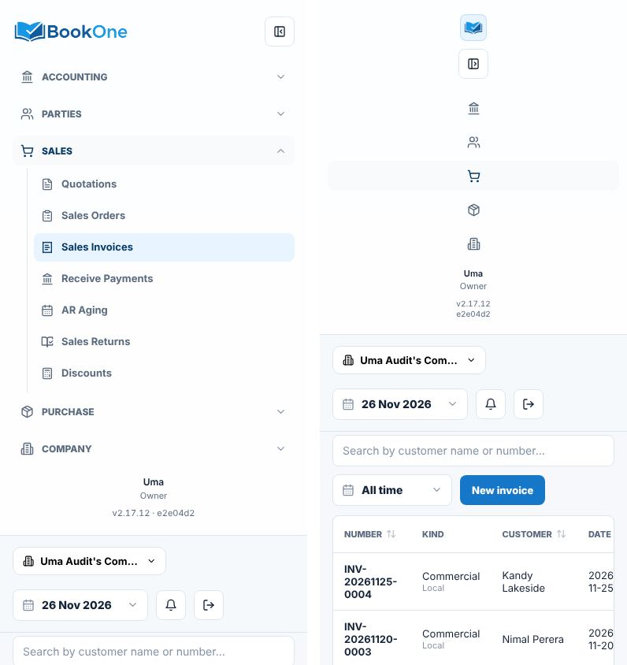

**Suggested fix.** Below 1024px render the sidebar as an off-canvas drawer: `.sidebar{position:fixed;inset:0 auto 0 0;width:min(84vw,300px);transform:translateX(-100%);transition:transform .2s;z-index:50}` `.sidebar[data-open=true]{transform:none}` plus a backdrop. Add a hamburger button to the top bar that toggles it, default closed, close on route change and on Escape/backdrop tap. Keep the current static sidebar at >=1024px.

## UI-02

**Tablet: fixed 268px sidebar leaves ~500px for content; pages overflow sideways and nested forms collapse**  
Severity: **High** · Area: App shell, settings forms, wide pages · Viewport: Tablet 768x1024  
Screens: /transactions (+225px), /advances (+250px), /company/team (+286px), /company/team/jobs (+286px), /purchase/orders/{id} (+267px); cramped: /company/details, /company/tax, all document forms

**What is wrong.** The desktop sidebar stays at full width on tablet. Several pages become wider than the viewport (horizontal page scroll; the Transactions filter row spills out of its card and the search box overlaps the Party field). Company details puts a 2-column field grid inside a 2-column page grid, so inputs are ~82px wide and values are cropped ("Sri Lank", "Asia/Col", TIN placeholder "Used on"). The bell icon button in the top bar is squeezed to ~18px wide.

**Steps to reproduce.**
1. Set the window to 768x1024.
2. Open /transactions: the page scrolls horizontally; Filter and Clear sit outside the card.
3. Open /company/details: field values are cut off.

**Evidence.**

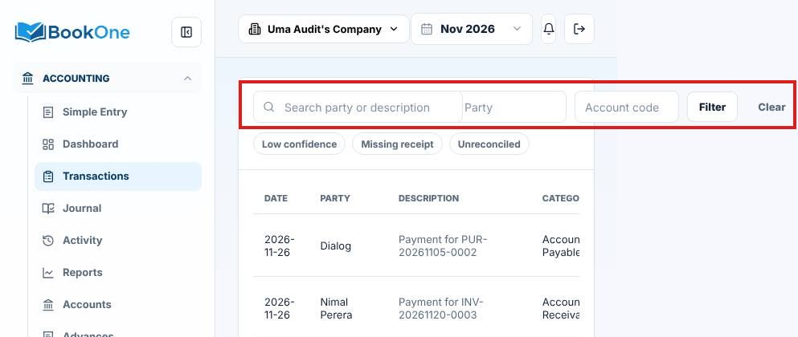

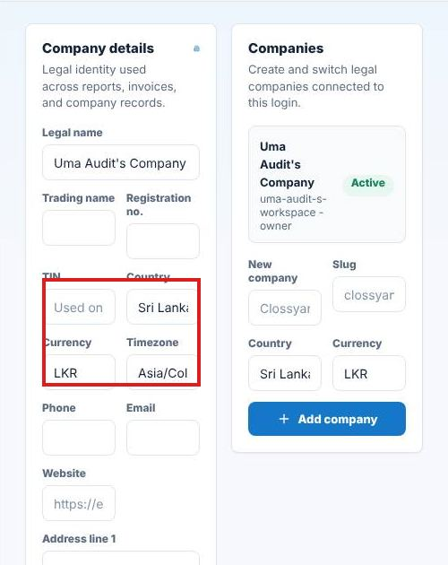

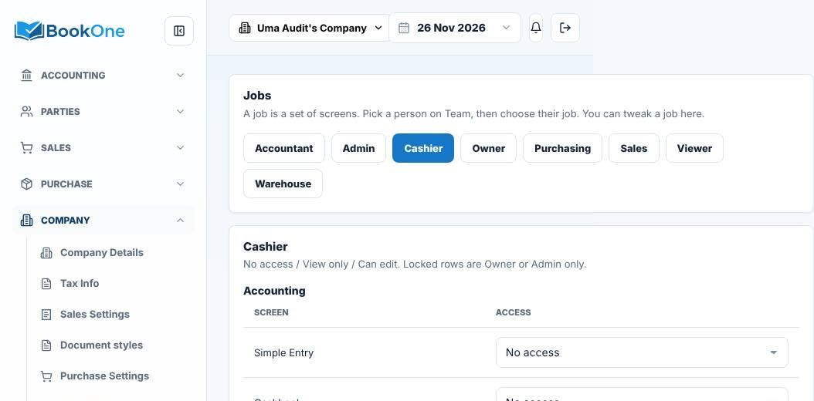

**Suggested fix.** Use the UI-01 drawer below 1024px (or a 64px icon rail). Make field grids content-driven: `.form-grid{display:grid;grid-template-columns:repeat(auto-fit,minmax(220px,1fr));gap:12px 16px}`. Stack the two settings cards below 1100px (`grid-template-columns:1fr`). Give toolbar rows `flex-wrap:wrap` with `min-width:0` on inputs. Top bar icon buttons: `flex:0 0 40px`.

## UI-03

**Mobile/tablet tables: key columns (Amount, Status, Actions) are off-screen; document numbers and dates break mid-token**  
Severity: **High** · Area: All list tables · Viewport: Mobile, Tablet  
Screens: /sales/invoices, /sales/quotations, /sales/orders, /purchase/*, /parties/*, /accounts, /transactions, /journal, /sales/aging, /purchase/aging

**What is wrong.** Tables keep desktop columns and scroll horizontally with no visible scroll cue. On a phone only Number/Kind/Customer are visible; the money, status and action columns need a sideways swipe nobody knows about. Document numbers wrap as "INV-/20261125-/0004" and dates as "2026-/11-26".

**Steps to reproduce.**
1. At 390px open /sales/invoices.
2. Only 3 of 7 columns show; Total and Actions are hidden to the right.

**Evidence.**

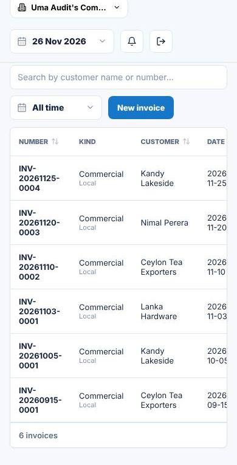

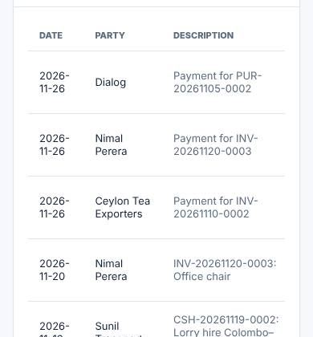

**Suggested fix.** 1) `td.num, td.code, td.date{white-space:nowrap}`. 2) Below 640px switch list tables to stacked cards: each `<tr>` becomes a card, cells get `data-label` and `td::before{content:attr(data-label)}`; show Number + Status on the first line, Customer, Date, Total right-aligned, Actions as a kebab. 3) Where a table must scroll, wrap it in `.table-scroll{overflow-x:auto}` with an edge shadow and a sticky first column.

## UI-04

**Transactions at 1440px: table is wider than its card; the Reverse action is cropped to "Reve"**  
Severity: **High** · Area: Accounting > Transactions · Viewport: Desktop 1440x900  
Screens: /transactions

**What is wrong.** The 10-column table overflows the card. The Action column is clipped ("Reve"), dates wrap onto two lines, amounts wrap ("-LKR / 14,990"), and account names wrap to three lines, making rows ~80px tall.

**Steps to reproduce.**
1. At 1440x900 open /transactions with a few posted entries.
2. Look at the right edge of the table.

**Evidence.**

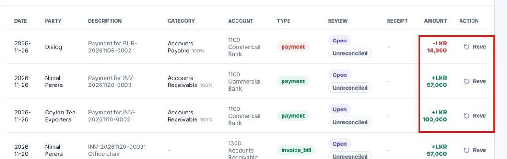

**Suggested fix.** `table-layout:fixed` with explicit widths (Date 96px, Party 140px, Description auto/min 220px, Category 140px, Account 150px, Type 110px, Review 120px, Receipt 64px, Amount 120px, Action 44px); nowrap on Date/Amount; make Reverse an icon button with tooltip and aria-label; let Description wrap. Show Account as code on line 1, name muted on line 2.

## UI-05

**Mobile: sticky top bar takes 2 rows (~120px) and truncates the company name**  
Severity: **High** · Area: App shell · Viewport: Mobile  
Screens: All

**What is wrong.** The sticky header wraps to two rows (company switcher on row 1; date, bell, logout on row 2) and stays on screen while scrolling, using ~14% of the viewport. The company name is truncated to "Uma Audit's Com…".

**Steps to reproduce.**
1. At 390px open any form (e.g. an invoice draft) and scroll.

**Evidence.**

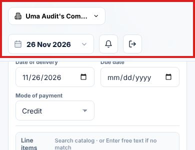

**Suggested fix.** One 56px row below 640px: hamburger | company switcher (`flex:1;min-width:0;text-overflow:ellipsis`) | icon-only date button | overflow menu holding notifications and logout. Or make the header non-sticky on mobile.

## UI-06

**AgentBridge: "Connected clients" table is unstyled and collides on mobile**  
Severity: **High** · Area: Company > AgentBridge (must-have feature) · Viewport: All; worst on mobile  
Screens: /company/agent-bridge

**What is wrong.** The Connected clients table uses browser-default styling: 17px bold headers that do not line up with the rest of the page, the empty message as a long default-font paragraph. On mobile the headers run together ("ClientCompanyAllowedStatus Last use Creat…") and are cut by the card edge. The "AgentBridge developer guide" in the intro is not styled as a link.

**Steps to reproduce.**
1. Open /company/agent-bridge with no clients connected.
2. Scroll to Connected clients. Repeat at 390px.

**Evidence.**

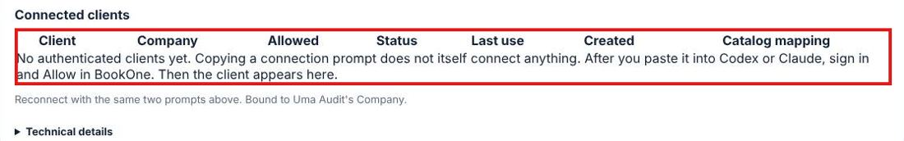

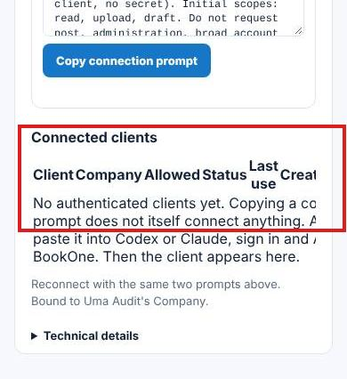

**Suggested fix.** Render it with the shared table component (`
<table class="table">`), put the empty state in `<tr><td colspan="7" class="table-empty">`, and on <640px use the stacked-card pattern from UI-03. Style the guide reference as `<a class="link">`.

## UI-07

**Document line items: Description field is too narrow (text cut) while SKU wastes space; unusable on mobile**  
Severity: **High** · Area: Sales invoice / quotation / order, purchase bill / PO / cash purchase / import / returns forms · Viewport: Desktop and Mobile  
Screens: /sales/invoices/new, /sales/invoices/{id}/edit, /sales/quotations/new, /sales/orders/new, /purchase/*/new

**What is wrong.** At 1440px the Description input in a line is ~150px wide ("Draft: Christmas deco…") while the SKU column is ~160px showing only "MANUAL". On mobile the Description input is ~32px ("Draft: C"), Unit price is cut and Amount/Discount/remove are off-screen.

**Steps to reproduce.**
1. Open a draft invoice (/sales/invoices/{id}/edit) with a free-text line.
2. Look at the line row; then repeat at 390px.

**Evidence.**

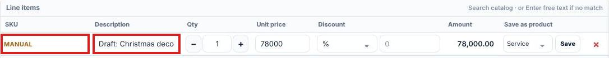

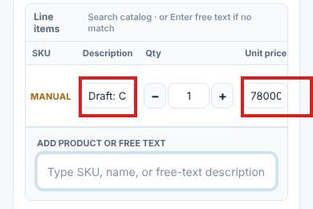

**Suggested fix.** Line grid: `grid-template-columns: 80px minmax(260px,3fr) 120px 120px 170px 130px 150px 32px` (SKU, Description, Qty, Unit price, Discount, Amount, Save as product, remove). Show MANUAL as a small tag under the description instead of its own column. Below 768px render each line as a card: Description full width, then Qty / Unit price / Discount in a 3-up row, Amount right-aligned, remove as icon.

## UI-08

**Mobile: stock transfer and adjustment forms are wider than the screen**  
Severity: **High** · Area: Inventory > Transfers / Adjustments (new) · Viewport: Mobile  
Screens: /inventory/transfers/new, /inventory/adjustments/new

**What is wrong.** Date, Reason, Notes inputs are fixed at 720px wide and the product line table does not shrink, so the fields run off the card and the Qty column is cut. Retest with data (26 Nov): the page no longer widens, but the card now clips the inputs on the right, so the product select text and the Qty column are cut off at 390px (same fix).

**Steps to reproduce.**
1. At 390px open /inventory/transfers/new.

**Evidence.**

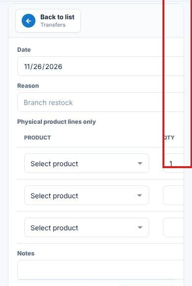

**Suggested fix.** `width:100%;max-width:720px;box-sizing:border-box` on the inputs; product lines as stacked rows (Product full width, Qty below) under 640px.

## UI-09

**Tablet: "Receive or bill from PO" table spills outside its card**  
Severity: **High** · Area: Purchase order detail · Viewport: Tablet  
Screens: /purchase/orders/{id}

**What is wrong.** The receive/bill table (Ordered, Received, Billed, Remaining, This qty, Unit price) extends ~267px past the card and the viewport; Remaining values sit on the card border.

**Steps to reproduce.**
1. At 768px open a confirmed PO.

**Evidence.**

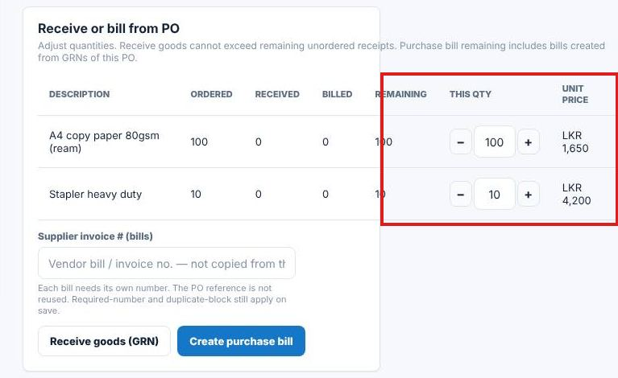

**Suggested fix.** Wrap the table in `.table-wrap{overflow-x:auto}`; reduce the qty stepper to a 72px input; under 900px stack per line.

## UI-33

**Rental calendar timeline widens the whole page instead of scrolling inside its card**  
Severity: **High** · Area: Inventory > Rental calendar (Timeline view) · Viewport: All; worst on tablet and mobile  
Screens: /inventory/calendar (default Timeline view)

**What is wrong.** The 30-day grid has a fixed minimum width and no scroll container, so the page grows sideways: 1578px wide at 1440 (+138px), 1578px at 768 (+810px) and 1298px at 390. The "On rent now" button and the right end of the grid sit outside the top bar and page frame, and at 1440 the last days (28 to 30) need a horizontal page scroll. Booking bars are cut to "40 · 24…" and "150 · 28–30 · K…" with no way to read the full label.

**Steps to reproduce.**
1. Have at least one hire booking (sales order with hire dates) in the month.
2. Open /inventory/calendar at 1440×900, then at 768 and 390.
3. Scroll right: the top bar stops at 1440 while the grid and "On rent now" continue.

**Evidence.**

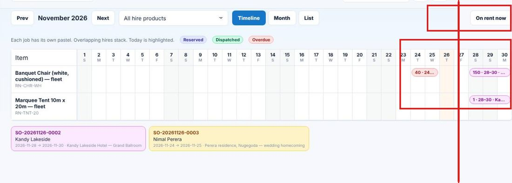

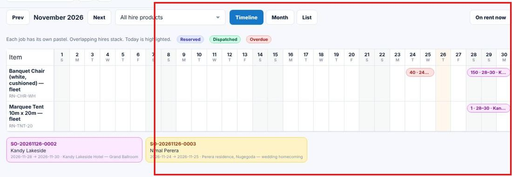

**Suggested fix.** Wrap the timeline in `
` inside the card and let the page stay at viewport width. Make the Item column `position:sticky;left:0` with a background so names stay visible while scrolling. Let the toolbar wrap (`flex-wrap:wrap`) so "On rent now" stays inside the frame. Give bars a `title` (or tooltip) with the full "qty · dates · customer" text, and on screens under 768px default to the List view.

## UI-34

**POS terminal on tablet and phone: cart and Pay button are pushed below the product grid**  
Severity: **High** · Area: POS terminal (/pos) · Viewport: Tablet 768x1024, Mobile 390x844  
Screens: /pos

**What is wrong.** Below desktop width the two-pane terminal stacks: product grid first, then the cart, totals and Pay. On a 768×1024 tablet (a typical POS device) the Pay button is at y≈1130, below the fold, and on a phone it is at the bottom of a 2645px page after every product tile. The header also wraps to three rows on tablet and five on phone. A cashier has to scroll after every scan to see the cart and total.

**Steps to reproduce.**
1. Open a shift and go to /pos at 768×1024.
2. Tap a product: the cart line is added off-screen; scroll down to find the total and Pay.
3. Repeat at 390×844.

**Evidence.**

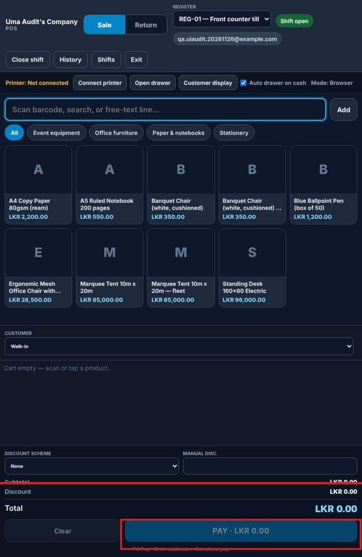

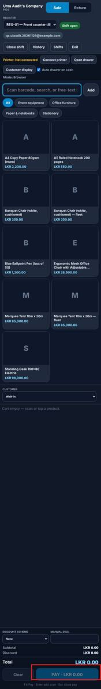

**Suggested fix.** Keep the terminal two-pane down to 768px (grid `minmax(0,1fr) 320px`, product tiles `repeat(auto-fill,minmax(120px,1fr))`). Under 768px show a sticky bottom bar with item count, total and Pay (`position:sticky;bottom:0`) that opens the cart as a bottom sheet. Collapse the header actions (Close shift, History, Shifts, printer and drawer buttons) into one overflow menu under 1024px.

## UI-10

**Jobs: Access dropdowns zig-zag because each section's table sizes its own columns**  
Severity: **Medium** · Area: Company > Team > Jobs · Viewport: All  
Screens: /company/team/jobs

**What is wrong.** Each section (Accounting, Parties, Sales, POS, Purchase, Inventory, Rental, Company, Team) is a separate auto-layout table, so the Access column starts at a different x in every section (from ~297px to ~440px). The page reads as misaligned.

**Steps to reproduce.**
1. Open /company/team/jobs and scroll.

**Evidence.**

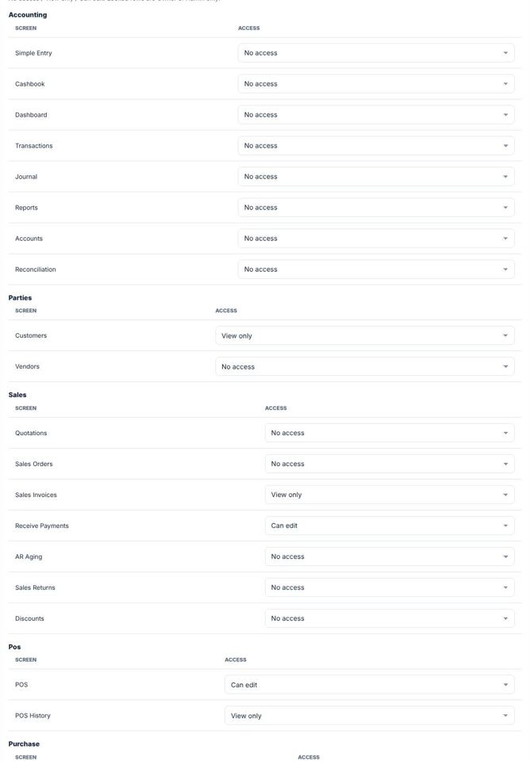

**Suggested fix.** `table{table-layout:fixed;width:100%}` with `<col style="width:55%"><col>` in every section, or one CSS grid `grid-template-columns: 1fr 320px` shared by all rows.

## UI-11

**Dashboard KPI rows: the two card groups have different top edges and heights**  
Severity: **Medium** · Area: Dashboard · Viewport: Desktop, Tablet  
Screens: /dashboard

**What is wrong.** "Selected period" cards start at y=183 and are 102px tall; "As of range end" cards start ~8px lower and are shorter (no comparison line). The row looks broken. Below it, the Sales trend card has an empty band where the Cash card has a summary line.

**Steps to reproduce.**
1. Open /dashboard (Month to date).

**Evidence.**

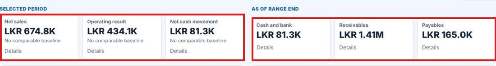

**Suggested fix.** Put both groups in one grid row with `align-items:stretch`; give the group label the same height; give all KPI cards the same structure (reserve the comparison line with min-height). Add the matching summary line to the Sales trend card ("Net sales 674,800").

## UI-12

**Dashboard charts: uneven x-axis ticks, only two raw y labels, unreadable on mobile**  
Severity: **Medium** · Area: Dashboard · Viewport: All  
Screens: /dashboard

**What is wrong.** X ticks are 01/11, 06/11, 11/11, 13/11, 16/11, 21/11, 26/11 (11/11 and 13/11 collide). Y axis shows only the max and 0 as raw numbers ("432,800", "157,000"). On mobile tick labels are ~7px.

**Steps to reproduce.**
1. Open /dashboard with sales on several days.

**Evidence.**

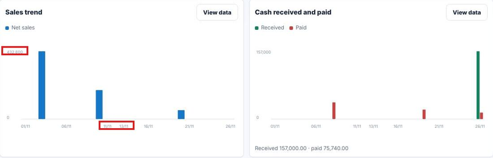

**Suggested fix.** Generate ticks at a fixed step (every 5 days), drop the extra mid tick; 3 to 5 'nice' y ticks with compact formatting (100K, 200K…) and gridlines; minimum 11px axis font, fewer ticks under 640px.

## UI-13

**Dashboard aging strip: bars are always full width; links use an unstyled 17px font**  
Severity: **Medium** · Area: Dashboard · Viewport: All  
Screens: /dashboard

**What is wrong.** Each aging bucket bar is drawn full width whether the bucket is 0 or 100% (Current shows a full bar at LKR 0). "View all customer overdue" / "View all supplier due" render in default 17px text, larger than the headings around them.

**Steps to reproduce.**
1. Open /dashboard.

**Evidence.**

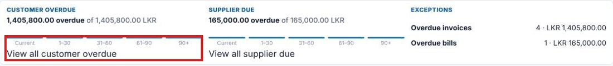

**Suggested fix.** Bar width = bucket amount / total (one stacked bar, or 5 bars with `width:%`); grey for zero. Style the links with the shared `.link` class (13px, brand colour).

## UI-14

**Money columns are left-aligned and receivable balances shown in red**  
Severity: **Medium** · Area: All tables with amounts · Viewport: All  
Screens: /sales/invoices, /sales/quotations, /sales/orders, /purchase/*, /parties/customers, /parties/vendors, /sales/payments, /sales/aging, /purchase/aging, invoice/PO detail line tables

**What is wrong.** Total, Balance, Unit price and Amount columns are left-aligned, so digits don't line up. Customer balances (money owed to the company) are red, which reads as an error/negative.

**Steps to reproduce.**
1. Open /sales/invoices and /parties/customers.

**Evidence.**

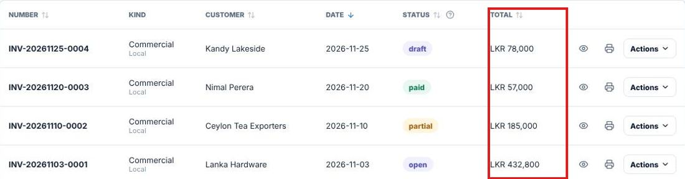

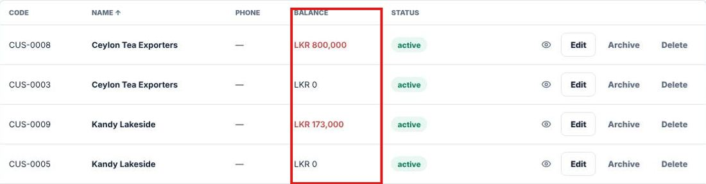

**Suggested fix.** `th.num,td.num{text-align:right;font-variant-numeric:tabular-nums}` on all money columns (Accounts and General Ledger already do this). Use neutral text for positive balances; red only for overdue/negative.

## UI-15

**Inconsistent page frame: no titles on list pages, toolbar jammed under the top bar, different gutters and widths**  
Severity: **Medium** · Area: Page layout · Viewport: All  
Screens: List pages (invoices, customers, POS, inventory...), /accounts, /company/commerce, /accounts/opening

**What is wrong.** List pages have no page title and their toolbar starts 5px below the top bar (y≈77) while card pages start at y≈97. Accounts uses a tinted, un-carded header. Commerce Integrations uses a 285px left gutter (others 297) and a full-height card. Opening balances is limited to ~895px wide while other forms are full width.

**Steps to reproduce.**
1. Compare /sales/invoices, /accounts, /company/commerce and /company/details.

**Evidence.**

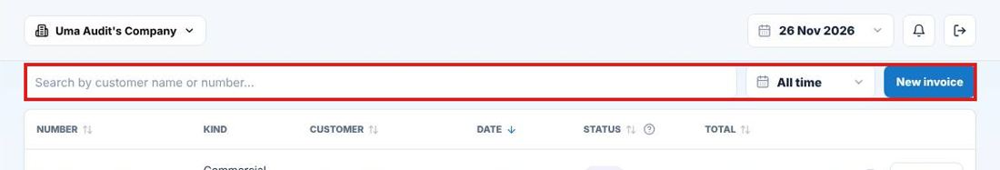

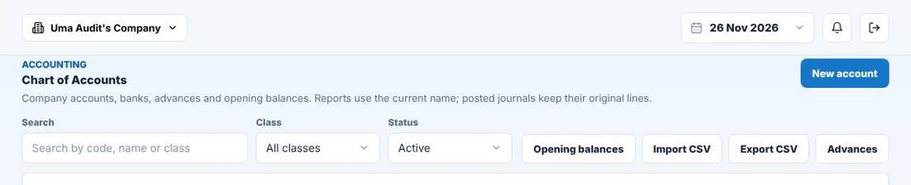

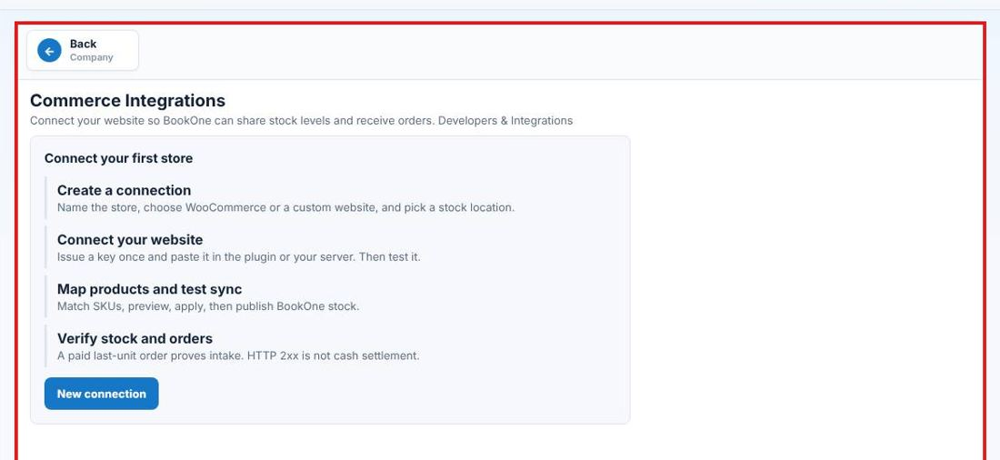

**Suggested fix.** One PageShell component: `padding:24px 28px`, an `h1.page-title` (can be compact) + optional actions on the right, then content. Same max-width for every page (or none), same card component. Remove per-page outer wrappers on Commerce and Opening balances.

## UI-16

**Checkboxes touch their labels and sit off the text baseline**  
Severity: **Medium** · Area: Settings forms · Viewport: All  
Screens: /company/purchase, /company/sales (VAT registered, credit limits, POS Active)

**What is wrong.** Checkbox and label have no gap ("☐Require approval…") and the box sits ~6px above the label text.

**Steps to reproduce.**
1. Open /company/purchase.

**Evidence.**

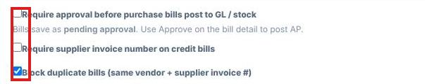

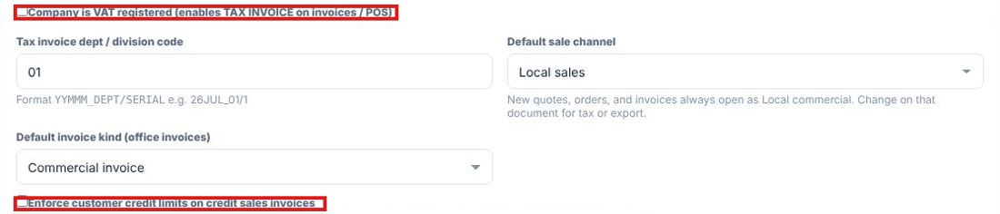

**Suggested fix.** Use the same checkbox row as AgentBridge settings: `.check-row{display:flex;align-items:center;gap:8px}`; wrap input inside the label.

## UI-17

**Sales settings: POS register form fields are scattered; empty register table has no message**  
Severity: **Medium** · Area: Company > Sales settings · Viewport: Desktop  
Screens: /company/sales

**What is wrong.** "Print mode" sits alone at the top-right with an empty block to its left; Code/Name start lower; "Active" checkbox floats under Location. The registers table shows only headers.

**Steps to reproduce.**
1. Open /company/sales and scroll to POS registers.

**Evidence.**

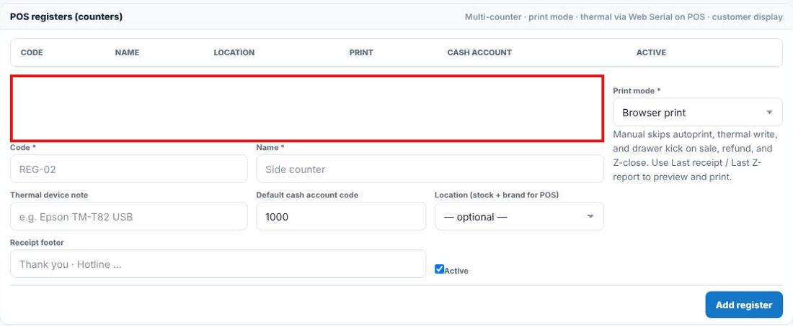

**Suggested fix.** 3-column grid: Code | Name | Print mode, then Thermal note | Cash account | Location, then Receipt footer (span 2) | Active. Put the print-mode help text under its field. Add an empty row: "No registers yet".

## UI-18

**Desktop sidebar: menu is cut off by the user footer at 900px height**  
Severity: **Medium** · Area: App shell · Viewport: Desktop 1440x900  
Screens: All Company pages

**What is wrong.** With COMPANY expanded the list runs under the footer: "Team" is half hidden (its active pill is clipped on /company/team) and Jobs/Groups are not visible, with no scroll cue.

**Steps to reproduce.**
1. At 1440x900 open /company/details.

**Evidence.**

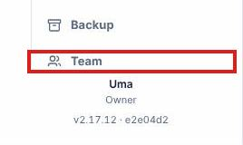

**Suggested fix.** Sidebar as a flex column: nav `flex:1;min-height:0;overflow-y:auto` with a bottom fade, footer `flex-shrink:0`. Auto-collapse other sections when one opens.

## UI-19

**Inventory, POS and Rental routes stay reachable with no sidebar entry when the module is off**  
Severity: **Medium** · Area: Navigation · Viewport: All  
Screens: /inventory/*, /sales/pos, /sales/pos/shifts, /company/rental

**What is wrong.** Retest with modules on (26 Nov): the INVENTORY group appears and highlights the current page correctly, so the main problem is gone. With the module off (first pass), /inventory/*, /sales/pos and /company/rental still load, the sidebar shows no group for them and ACCOUNTING is expanded with nothing active.

**Steps to reproduce.**
1. Open /inventory/levels or /sales/pos.

**Evidence.**

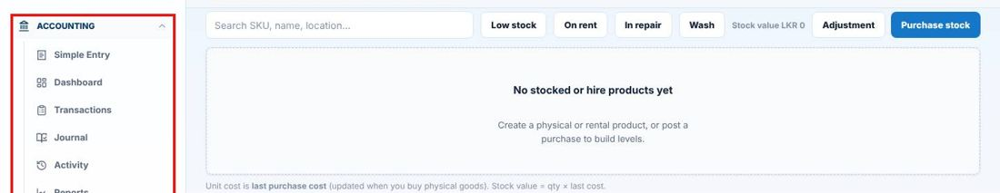

**Suggested fix.** When a module is off, redirect its routes to a short "This module is off for your company" page (or show the group disabled with that note). No change needed when the module is on.

## UI-20

**Receive payment: amount inputs show raw numbers, columns unbalanced**  
Severity: **Medium** · Area: Sales > Receive payments / Purchase > Pay vendors · Viewport: Desktop  
Screens: /sales/payments/new, /purchase/payments/new

**What is wrong.** Amount placeholders are unformatted ("432800") next to formatted balances ("LKR 432,800"); both are left-aligned; a large empty area sits right of the amount column. The page header band is a different background from the card below it.

**Steps to reproduce.**
1. Open /sales/payments/new.

**Evidence.**

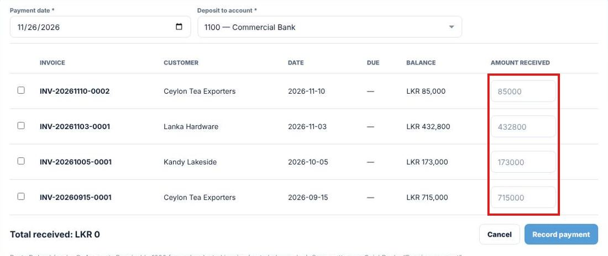

**Suggested fix.** Right-align Balance and Amount, format the placeholder with grouping, put the amount column at the right edge (`margin-left:auto`), use the same card for header and table.

## UI-21

**Invoice detail header: big empty gap and wrapped meta values**  
Severity: **Medium** · Area: Sales/purchase document detail · Viewport: Desktop  
Screens: /sales/invoices/{id}, /purchase/purchases/{id}, /purchase/orders/{id}

**What is wrong.** The totals box on the right sets the header height, leaving ~90px of blank space between the status line and the Date/Delivery row; "Commercial — no output VAT" wraps in a 6-column row with spare width.

**Steps to reproduce.**
1. Open any posted invoice.

**Evidence.**

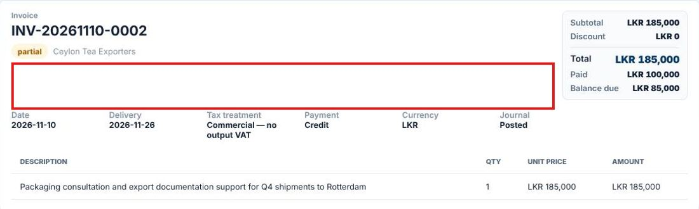

**Suggested fix.** Header as `grid-template-columns:1fr auto; align-items:start`, put the meta grid in the left column directly under the title; meta grid `repeat(auto-fit,minmax(140px,1fr))`.

## UI-22

**Quotation form totals box is not right-aligned (differs from invoice form)**  
Severity: **Medium** · Area: Sales > Quotations (new/edit) · Viewport: Desktop  
Screens: /sales/quotations/new, /sales/quotations/{id}/edit

**What is wrong.** Totals box ends at x≈1119 leaving a 280px empty strip to its right, while the invoice form places totals at the right edge.

**Steps to reproduce.**
1. Open /sales/quotations/new.

**Evidence.**

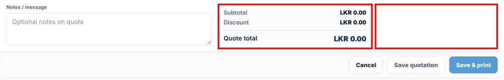

**Suggested fix.** Reuse the invoice footer layout: notes left (flex:1), discount, totals `margin-left:auto;width:266px`.

## UI-35

**Product form: Cancel / Save bar sits on top of the Short description editor**  
Severity: **Medium** · Area: Inventory > Products (new / edit) · Viewport: Desktop 1440x900  
Screens: /inventory/products/new, /inventory/products/{id}/edit

**What is wrong.** The form card is fixed to the viewport height and its action bar has no background or separation, so on the Identity tab the Cancel and Save product buttons share a row with the editor toolbar and the editor itself is cut in half ("A short summary customers will see first" is clipped at the card edge).

**Steps to reproduce.**
1. Open /inventory/products/new at 1440×900.
2. Look at the bottom of the Identity tab.

**Evidence.**

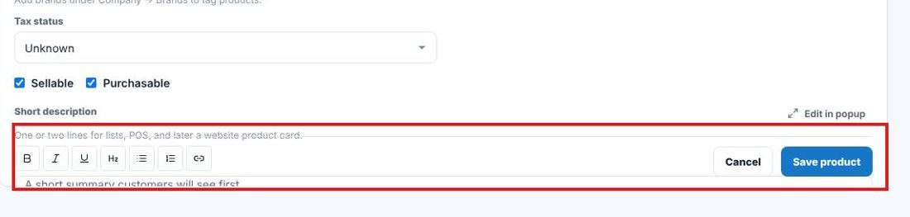

**Suggested fix.** Make the footer a real sticky bar: `position:sticky;bottom:0;background:var(--surface);border-top:1px solid var(--line);padding:12px 16px` and give the scroll area `padding-bottom` equal to the bar height. Or let the card grow with content instead of fixing it to 100vh (same root cause as UI-32).

## UI-36

**Dispatch / returns: mixed label styles, GL codes in labels, tall action column; page overflows on mobile**  
Severity: **Medium** · Area: Inventory > Dispatch / returns · Viewport: All; overflow on mobile  
Screens: /inventory/on-rent

**What is wrong.** Each job card mixes stacked labels (Tender, Extend hire to) with inline labels squeezed beside inputs ("Agreed damage (4450)", "Agreed late fee (4450)", "Extra hire (4400)"), and shows raw GL account numbers to the user. The "Confirm overlap" checkbox floats next to the date. In the lines table, Dispatch / Open doc / Packing list are stacked so each row is about 110px tall. At 390px the table forces the page to 738px wide.

**Steps to reproduce.**
1. Create a sales order with hire dates and confirm it.
2. Open /inventory/on-rent at 1440 and at 390.

**Evidence.**

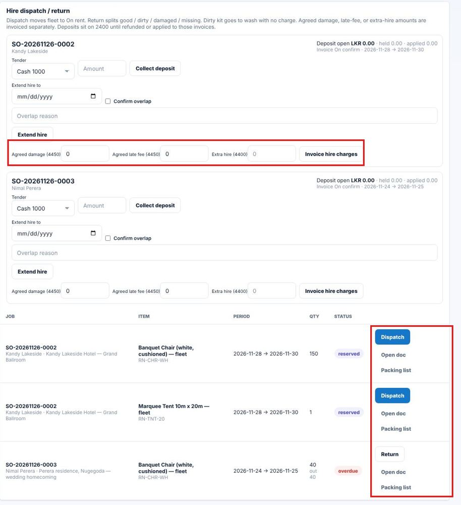

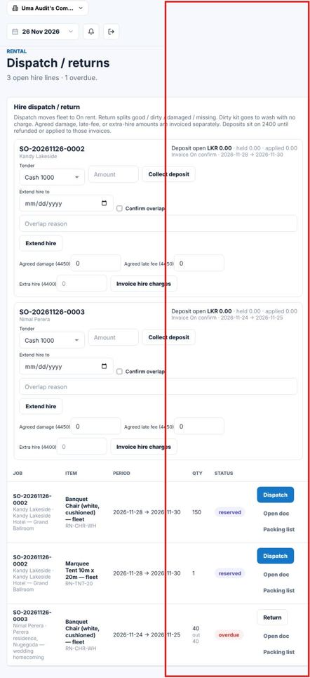

**Suggested fix.** Use one form grid per card: stacked labels above every input, in rows of 3 (`grid-template-columns:repeat(auto-fit,minmax(180px,1fr))`). Move the account numbers to a help tooltip or drop them. Put Open doc and Packing list into a row-level "⋯" menu and keep only the primary action (Dispatch / Return) as a button. Under 640px render the lines as stacked cards (shared table fix, UI-03).

## UI-37

**Stock levels: stock value squeezed into the toolbar; money and reorder cells wrap**  
Severity: **Medium** · Area: Inventory > Stock levels / Low stock · Viewport: Desktop 1440x900 (worse on tablet)  
Screens: /inventory/levels, /inventory/levels?low=1, /inventory/levels?fleet=on_rent

**What is wrong.** The total stock value is small grey text wedged between the Wash filter and the Adjustment button, so it reads as a disabled control. Value cells wrap to two lines ("LKR / 495,000"), and the Reorder cell stacks a "blocked" pill over "≤ 50", so rows have uneven heights. Money is left-aligned (see UI-14).

**Steps to reproduce.**
1. Have stock in more than one location.
2. Open /inventory/levels at 1440×900.

**Evidence.**

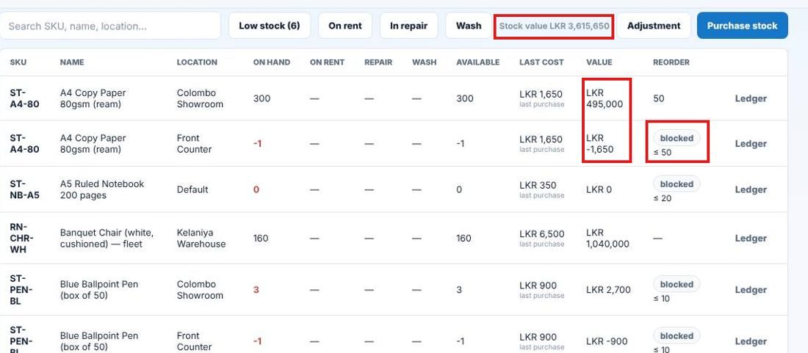

**Suggested fix.** Move "Stock value LKR 3,615,650" into a summary line or stat card above the table. Give money cells `white-space:nowrap;text-align:right;font-variant-numeric:tabular-nums`. Show reorder as one line ("≤ 50 · blocked") or a single status pill with the level in a tooltip.

## UI-23

**Document form header grid: field edges don't line up row to row**  
Severity: **Low** · Area: Document forms · Viewport: Desktop  
Screens: /sales/invoices/new, /sales/quotations/new, /purchase/*/new

**What is wrong.** Row 1 is a 3-column grid and row 2 a 4-column grid, so column edges are offset (e.g. Invoice kind ends at 895, Invoice date at 895 but Customer starts at 908 and Due date at 1158).

**Steps to reproduce.**
1. Open /sales/invoices/new.

**Evidence.**

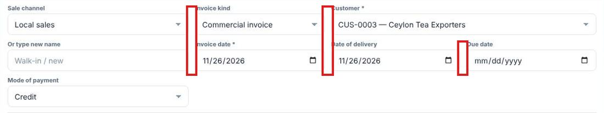

**Suggested fix.** Single 4-column grid; Customer `grid-column:span 2`; Mode of payment in column 1 of row 3.

## UI-24

**Date formats are inconsistent (US mm/dd/yyyy in inputs and printouts)**  
Severity: **Low** · Area: Forms, print · Viewport: All  
Screens: All native date inputs, print preview

**What is wrong.** Native date inputs show 11/26/2026 (browser locale) and the printed invoice shows 11/10/2026, while the app shows 26 Nov 2026 and ISO 2026-11-26 in tables. Opening balances uses a different custom date picker.

**Steps to reproduce.**
1. Open /sales/invoices/new; then Print an invoice.

**Evidence.**

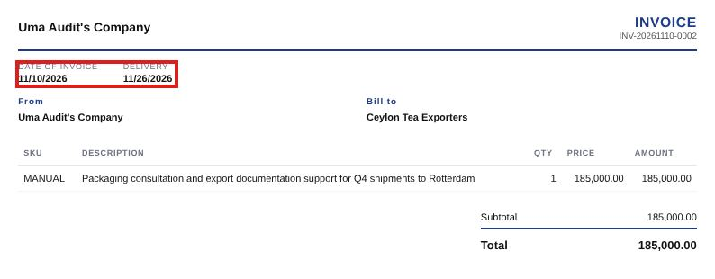

**Suggested fix.** Use the shared DateField (DS-11) everywhere and format printed dates with the company locale (e.g. `Intl.DateTimeFormat('en-GB',{day:'2-digit',month:'short',year:'numeric'})`).

## UI-25

**Backup page uses native unstyled controls**  
Severity: **Low** · Area: Company > Backup · Viewport: Desktop  
Screens: /company/backup

**What is wrong.** "Choose File" is the browser default file input and "Restore company data first" is an unstyled disabled native button; password fields only fill half the card; the yellow notice touches the paragraph above.

**Steps to reproduce.**
1. Open /company/backup.

**Evidence.**

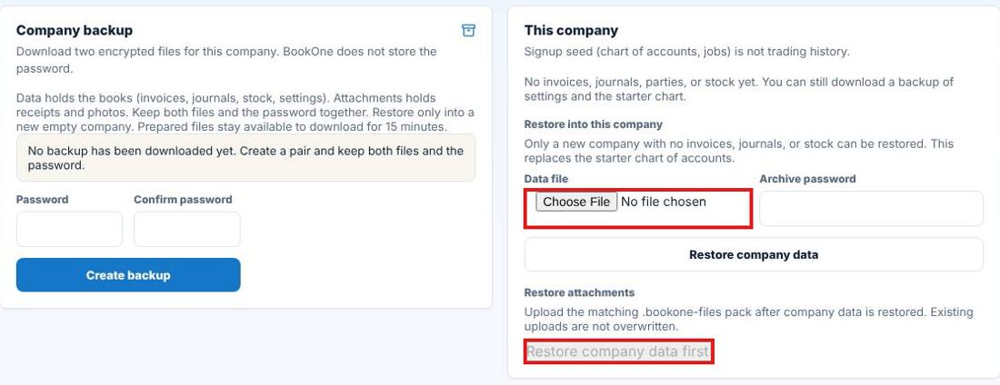

**Suggested fix.** Use the app Button and a styled file picker (hidden input + Button + file name); `.notice{margin-top:12px}`; password fields in the standard 2-column grid.

## UI-26

**AR/AP aging toolbar and bucket cards misaligned**  
Severity: **Low** · Area: Sales > AR Aging, Purchase > AP Aging · Viewport: Desktop  
Screens: /sales/aging, /purchase/aging

**What is wrong.** The date input is indented 8px from its label, touches the Refresh button and is a different height (40 vs 37px). The six bucket cards stop at x≈1250, leaving an empty strip on the right.

**Steps to reproduce.**
1. Open /sales/aging.

**Evidence.**

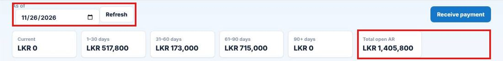

**Suggested fix.** Toolbar `display:flex;gap:8px;align-items:end`; same 40px control height; bucket cards `grid-template-columns:repeat(6,1fr)`.

## UI-27

**Raw codes shown as labels (invoice_bill, lowercase statuses)**  
Severity: **Low** · Area: Journal, Transactions, lists · Viewport: All  
Screens: /journal, /transactions, /parties/*, /company/team

**What is wrong.** Type shows "invoice_bill"; statuses show "active", "open" in lowercase.

**Steps to reproduce.**
1. Open /journal.

**Evidence.**

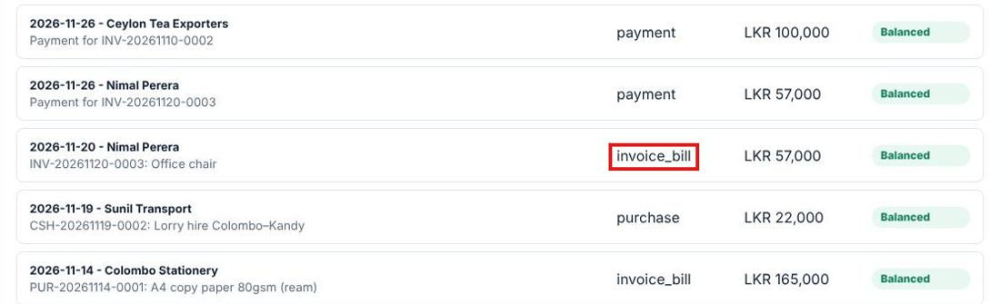

**Suggested fix.** Map enum values to display labels ("Invoice / bill", "Active") in one label helper.

## UI-28

**Reports: rows not ordered by account code, no totals, expenses coloured green**  
Severity: **Low** · Area: Reports (P&L, Trial balance) · Viewport: All  
Screens: /reports?report=pnl, /reports?report=trial

**What is wrong.** Accounts appear in arbitrary order (3000, 1400, 2100, 3100…). Trial balance has no Debit/Credit totals row. P&L shows expense amounts in the same green as revenue and no section subtotals. Zero rows dominate.

**Steps to reproduce.**
1. Open /reports?report=trial.

**Evidence.**

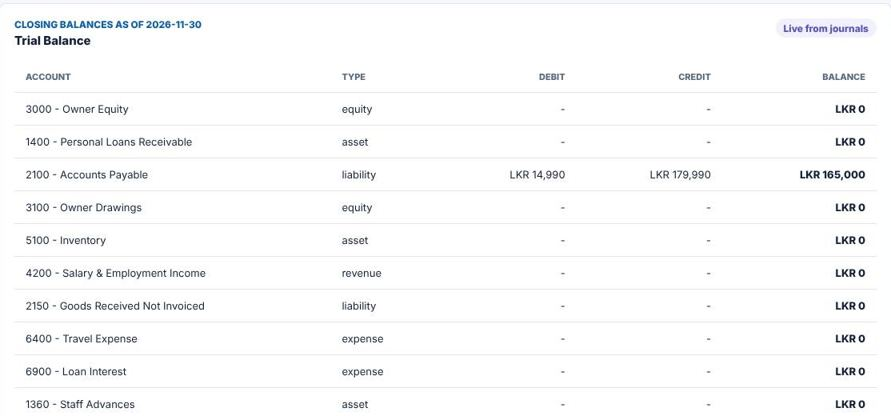

**Suggested fix.** Sort by code; add totals row (and section subtotals on P&L); neutral colour for amounts; a "Hide zero balances" toggle (default on).

## UI-29

**Save button placement differs between settings pages**  
Severity: **Low** · Area: Company settings · Viewport: Desktop  
Screens: /company/tax (full width), /company/details (full width), /company/purchase, /company/sales (right-aligned)

**What is wrong.** Some settings pages use a full-width primary button, others a right-aligned one.

**Steps to reproduce.**
1. Compare /company/tax and /company/purchase.

**Evidence.**

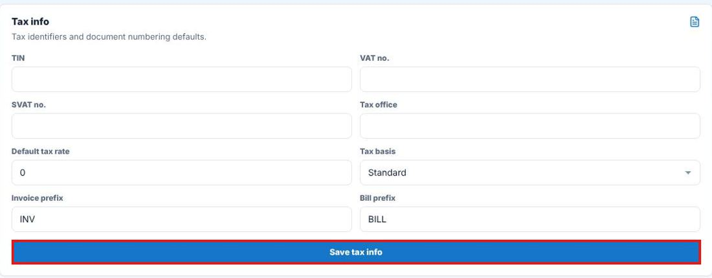

**Suggested fix.** Shared form footer: divider + right-aligned primary button.

## UI-30

**Sidebar icons repeat for different items**  
Severity: **Low** · Area: Sidebar · Viewport: All  
Screens: All

**What is wrong.** Tax Info, Sales Settings, Document styles and AgentBridge share one document icon; Locations reuses the bank icon of Accounting; Purchase Settings and Commerce use the same cart.

**Steps to reproduce.**
1. Expand COMPANY in the sidebar.

**Evidence.**

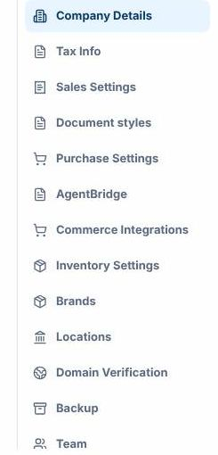

**Suggested fix.** Distinct icons (e.g. Percent for Tax, Palette for Document styles, Bot/Plug for AgentBridge, Store for Commerce, MapPin for Locations).

## UI-31

**Documentation: page title duplicated; nav items have bevelled borders**  
Severity: **Low** · Area: /docs · Viewport: All  
Screens: /docs

**What is wrong.** "BookOne documentation" appears as two H1s one under the other; sidebar items show a 3D right/bottom border unlike the app.

**Steps to reproduce.**
1. Open /docs.

**Evidence.**

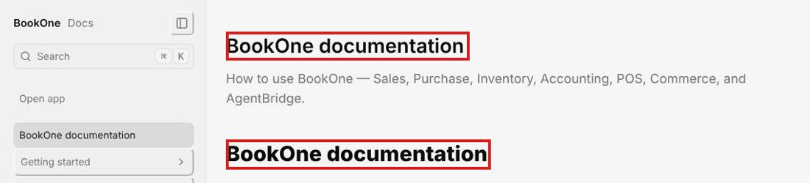

**Suggested fix.** Drop the markdown H1 when the page header already renders the title; flat 1px border on nav items.

## UI-32

**Party form card is stretched to the full viewport height**  
Severity: **Low** · Area: Customers/Vendors new & edit · Viewport: Desktop  
Screens: /parties/customers/new, /parties/vendors/new, edit

**What is wrong.** The Identity tab fills ~40% of the card and the rest is blank down to the Save bar.

**Steps to reproduce.**
1. Open /parties/customers/new.

**Evidence.**

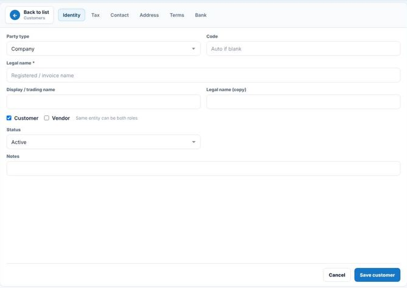

**Suggested fix.** Remove the forced min-height on the form card; keep the action bar sticky to the bottom of the viewport instead.

## UI-38

**Rental month view: booking chips unreadable on mobile; overdue hire not shown as overdue**  
Severity: **Low** · Area: Inventory > Rental calendar (Month view) · Viewport: Mobile 390x844; Desktop  
Screens: /inventory/calendar?view=month

**What is wrong.** At 390px each day cell is about 40px wide, so every booking chip truncates to one letter and an ellipsis ("N…", "K…"). On all sizes the chip colour is the job pastel only: SO-20261126-0003 is overdue (ended 25 Nov, still out) and the timeline marks it red, but the month view shows it in the same yellow as a normal booking, even though the legend above lists Overdue in red.

**Steps to reproduce.**
1. Have one hire whose end date is before today and not returned.
2. Open /inventory/calendar?view=month at 1440, then at 390.

**Evidence.**

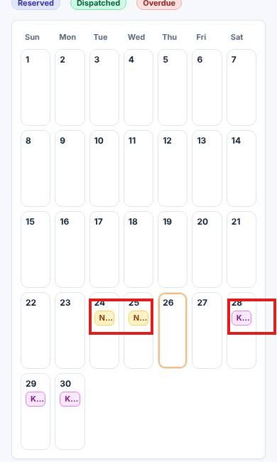

**Suggested fix.** Under 640px replace chips with a coloured dot per booking and list the day's bookings below the grid when a day is tapped (or default to List view). Add the status border used in the timeline (`hire-cal-chip-late`) to month chips so overdue jobs show red regardless of job pastel.

## Incidental functional finding (outside UI scope, for the functional thread)

Shareable report with images: https://claude.ai/artifact/E5UyGKEMsCCaJq2U9xK185 (private until shared). This file is the repo copy; images are in `img/`.

**F-01 — Posting a sales document to an existing customer creates a duplicate customer when the display name differs from the legal name.** High.
The customer picker on invoice/quotation/order forms submits the display name (`partyName` = "Lanka Hardware") instead of the party id. When the customer's legal name differs ("Lanka Hardware & Building Supplies (Private) Limited"), posting creates a new customer (CUS-0007) and books the receivable there, leaving the real customer (CUS-0001) at LKR 0. Reproduced three times (CUS-0007, -0008, -0009) and the same pattern for vendors (8 vendor rows after creating 4). Repro: create customer with Legal name A and Display name B; New invoice, pick that customer, Post; Customers list now shows two rows named B and the balance sits on the new one. Fix: submit `partyId` from the select and resolve by id server-side; only create a party from the free-text "Or type new name" field.

Also noticed: on the quotation form the field named `placeOfSupply` holds payment terms and `paymentMode` holds the ship-via values (labels are right, field names are swapped), worth checking that the saved values land in the intended columns.

### From the Inventory, POS and Rental pass (26 Nov, modules on)

**F-02 — Stock can go negative without warning.** High. A POS sale from the Front Counter register (no stock there) and an adjustment at the Default location left on-hand at −1 and −2, with negative stock value (LKR −37,000). Fix: block or warn on issues that take a location below zero, unless the company allows negative stock.

**F-03 — Product save reports an error but still creates the product.** Medium. Saving a stocked product with opening quantity but no opening location shows "Pick a location for opening stock", yet the product is created with quantity 0. Fix: validate before insert and roll back on error.

**F-04 — Stock transfer form has no From and To location fields.** High. /inventory/transfers/new only has Date, Reason, product lines and Notes, so a transfer cannot say where stock moves from or to. The first line is also prefilled with A4 Copy Paper, qty 1. Fix: add required From/To location selects and start with empty lines.

**F-05 — Posted adjustment shows 0 lines.** Low. ADJ-20261126-0001 (one line, posted) shows LINES 0 in the adjustments list. Fix: count lines in the list query.

**F-06 — POS sells rental fleet items.** Medium. Rental products (Banquet Chair, Marquee Tent and their fleet variants) appear as sellable tiles in the POS grid at their hire price. Fix: exclude rental-type products from POS, or route them to a hire flow.

**F-07 — Purchase bill asks for hire dates when it contains a rental product.** Low. Buying rental fleet stock on a purchase bill requires hire-from/to dates, which do not apply to a purchase. Fix: only ask for hire dates on sales documents.

**F-08 — Sales order detail hides the hire details.** Medium. Hire from/to, event date, venue and guest count entered on the order form are not shown on the order detail page (only on Dispatch / returns). Fix: show a Hire block under the header on hire orders.

## Coverage and limits

- Covered: every sidebar route plus Inventory, POS, Rental routes reached by URL; list, empty, new, edit, detail and print-preview states for sales and purchase documents; reports (P&L, balance sheet, cash flow, GL, trial balance, VAT); company settings; AgentBridge; Commerce new-connection form.
- Data: 10 parties, 6 sales invoices (posted, partial, paid, draft), 2 quotations, 1 sales order, 1 PO, 2 credit purchases, 2 cash purchases, 1 customer receipt (2 invoices), 1 vendor payment.
- Second pass (26 Nov, Inventory, POS and Rental switched on for UI-A): 25 more routes in `routes-inv.txt` (products, categories, stock levels, ledger, transfers, adjustments, rental calendar Timeline/Month/List, dispatch / returns, POS list, shifts, full-screen terminal, rental and location settings). Data: 4 locations, 4 categories, 10 products (5 stocked, 4 rental fleet), 2 stock bills, 1 adjustment, 1 POS sale on an open shift, 2 hire orders (one reserved, one dispatched and overdue). Not covered: a posted stock transfer (form has no location fields, F-04) and service products.
- Automated detector (scripts/ui-layout-audit/detect.js) flags page overflow, off-viewport elements, clipped text, overlapping leaves and cropped field values; every finding above was confirmed by eye on the screenshots. Overlap hits from the collapsed sidebar panels on mobile were false positives and are not reported.

## Re-running

`scripts/ui-layout-audit/`: `audit.js <label> routes-full.txt desktop,tablet,mobile` with a logged-in `storage-state.json` (not committed). Seeding helpers: `seedcust.js`, `seeddocs.js`, `seed2.js`; module data: `seedinv1.js`, `seedprod.js`, `seedstock2.js`, `seedrent.js`, `seedmove.js`, `seedhire.js` (re-run `audit.js inv routes-inv.txt desktop,tablet,mobile`). Test account alias UI-A; its password is held privately by the owner, never in this repo.
