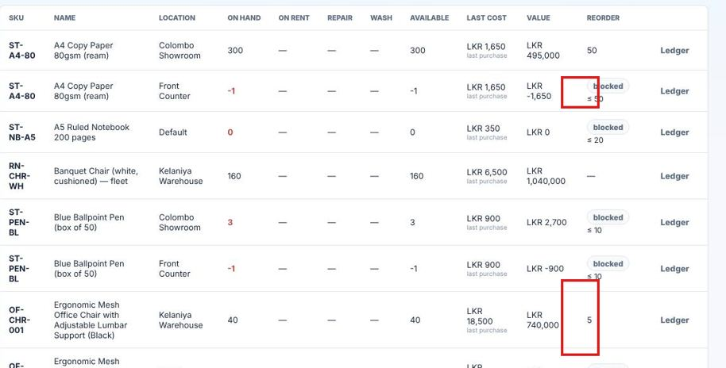
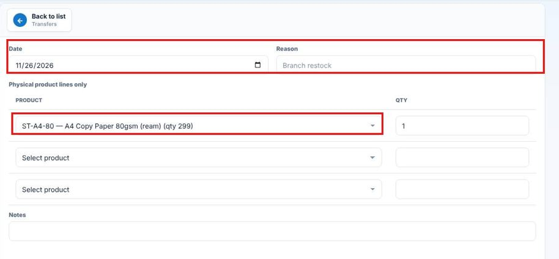
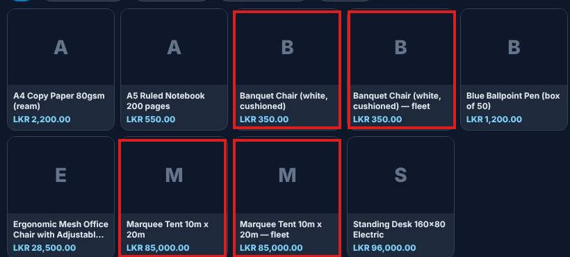
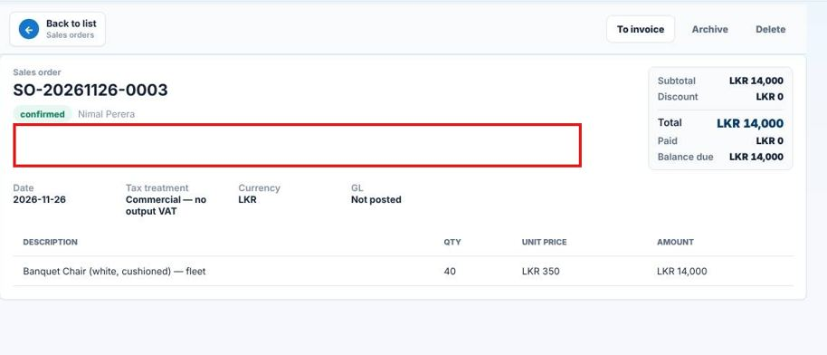

## Incidental functional finding (outside UI scope, for the functional thread)

Shareable report with images: https://claude.ai/artifact/E5UyGKEMsCCaJq2U9xK185 (private until shared). This file is the repo copy; images are in `img/`.

**F-01 — Posting a sales document to an existing customer creates a duplicate customer when the display name differs from the legal name.** High.
The customer picker on invoice/quotation/order forms submits the display name (`partyName` = "Lanka Hardware") instead of the party id. When the customer's legal name differs ("Lanka Hardware & Building Supplies (Private) Limited"), posting creates a new customer (CUS-0007) and books the receivable there, leaving the real customer (CUS-0001) at LKR 0. Reproduced three times (CUS-0007, -0008, -0009) and the same pattern for vendors (8 vendor rows after creating 4). Repro: create customer with Legal name A and Display name B; New invoice, pick that customer, Post; Customers list now shows two rows named B and the balance sits on the new one. Fix: submit `partyId` from the select and resolve by id server-side; only create a party from the free-text "Or type new name" field.

Also noticed: on the quotation form the field named `placeOfSupply` holds payment terms and `paymentMode` holds the ship-via values (labels are right, field names are swapped), worth checking that the saved values land in the intended columns.

### From the Inventory, POS and Rental pass (26 Nov, modules on)

**F-02 — Stock can go negative without warning.** High. A POS sale from the Front Counter register (no stock there) and an adjustment at the Default location left on-hand at −1 and −2, with negative stock value (LKR −37,000). Fix: block or warn on issues that take a location below zero, unless the company allows negative stock.

**F-03 — Product save reports an error but still creates the product.** Medium. Saving a stocked product with opening quantity but no opening location shows "Pick a location for opening stock", yet the product is created with quantity 0. Fix: validate before insert and roll back on error.

**F-04 — Stock transfer form has no From and To location fields.** High. /inventory/transfers/new only has Date, Reason, product lines and Notes, so a transfer cannot say where stock moves from or to. The first line is also prefilled with A4 Copy Paper, qty 1. Fix: add required From/To location selects and start with empty lines.

**F-05 — Posted adjustment shows 0 lines.** Low. ADJ-20261126-0001 (one line, posted) shows LINES 0 in the adjustments list. Fix: count lines in the list query.

**F-06 — POS sells rental fleet items.** Medium. Rental products (Banquet Chair, Marquee Tent and their fleet variants) appear as sellable tiles in the POS grid at their hire price. Fix: exclude rental-type products from POS, or route them to a hire flow.

**F-07 — Purchase bill asks for hire dates when it contains a rental product.** Low. Buying rental fleet stock on a purchase bill requires hire-from/to dates, which do not apply to a purchase. Fix: only ask for hire dates on sales documents.

**F-08 — Sales order detail hides the hire details.** Medium. Hire from/to, event date, venue and guest count entered on the order form are not shown on the order detail page (only on Dispatch / returns). Fix: show a Hire block under the header on hire orders.

## Coverage and limits

- Covered: every sidebar route plus Inventory, POS, Rental routes reached by URL; list, empty, new, edit, detail and print-preview states for sales and purchase documents; reports (P&L, balance sheet, cash flow, GL, trial balance, VAT); company settings; AgentBridge; Commerce new-connection form.
- Data: 10 parties, 6 sales invoices (posted, partial, paid, draft), 2 quotations, 1 sales order, 1 PO, 2 credit purchases, 2 cash purchases, 1 customer receipt (2 invoices), 1 vendor payment.
- Second pass (26 Nov, Inventory, POS and Rental switched on for UI-A): 25 more routes in `routes-inv.txt` (products, categories, stock levels, ledger, transfers, adjustments, rental calendar Timeline/Month/List, dispatch / returns, POS list, shifts, full-screen terminal, rental and location settings). Data: 4 locations, 4 categories, 10 products (5 stocked, 4 rental fleet), 2 stock bills, 1 adjustment, 1 POS sale on an open shift, 2 hire orders (one reserved, one dispatched and overdue). Not covered: a posted stock transfer (form has no location fields, F-04) and service products.
- Automated detector (scripts/ui-layout-audit/detect.js) flags page overflow, off-viewport elements, clipped text, overlapping leaves and cropped field values; every finding above was confirmed by eye on the screenshots. Overlap hits from the collapsed sidebar panels on mobile were false positives and are not reported.

## Re-running

`scripts/ui-layout-audit/`: `audit.js <label> routes-full.txt desktop,tablet,mobile` with a logged-in `storage-state.json` (not committed). Seeding helpers: `seedcust.js`, `seeddocs.js`, `seed2.js`; module data: `seedinv1.js`, `seedprod.js`, `seedstock2.js`, `seedrent.js`, `seedmove.js`, `seedhire.js` (re-run `audit.js inv routes-inv.txt desktop,tablet,mobile`). Test account alias UI-A; its password is held privately by the owner, never in this repo.
